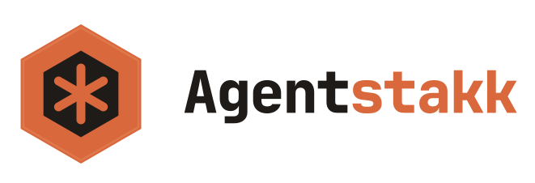

<div align="center">
  <picture>
    <source media="(prefers-color-scheme: dark)" srcset="docs/assets/images/lockup-dark.svg">
    
  </picture>
</div>

# Agentstakk

**An A-SDLC (Agentic Software Development Lifecycle) for Claude Code and Codex.**
Design, implement, review, test and document as one chain of skills.

[](https://github.com/serpro69/agentstakk/releases)
[](https://github.com/hesreallyhim/awesome-claude-code)
[](https://serpro69.github.io/agentstakk/)

You describe a feature. `/kk:design` turns it into a design, an implementation plan and tasks. `/kk:implement` works through the tasks. Each task is verified with `/kk:test` and gets an independent code review before it's done, so you don't have to remember to ask. Profiles give every step specific checks for Go, Java, JS/TS, Kotlin, Python and Kubernetes.

```
/kk:design → /kk:review-design → /kk:implement → /kk:review-code → /kk:test → /kk:document
```

**Does the built-in review matter?** We replayed five real reviews from [capy](https://github.com/serpro69/capy), a project built with Agentstakk. Plain Claude Code on the same model found 36% of the issues those reviews reported and the author kept, and nothing they missed. [Benchmarks and limits](https://serpro69.github.io/agentstakk/latest/benchmarks/) · [data](https://github.com/serpro69/agentstakk-bench)

<div align="center">
  <picture>
    
  </picture>
</div>

## Install

On macOS or Linux, you need Claude Code 2.1.295 or later, Bash, Git, `curl`, `jq` and Python 3.9+ on your `PATH`. Codex is optional. Install once per user account:

```bash
curl -fsSL https://raw.githubusercontent.com/serpro69/agentstakk/master/install.sh | bash
export PATH="$HOME/.local/bin:$PATH"
kk status
```

Start sessions with `kk claude` or `kk codex`. Codex needs a one-time trust review first; see [Installation and updates](docs/getting-started/install.md). To use only the Claude Code plugin without `kk`, see [Plugin-only setup](docs/getting-started/plugin-only.md).

## How it works

1. **Plan.** Run `/kk:design` and describe a feature. Claude asks refinement questions, then writes a design, an implementation plan and a task list to `docs/feat/wip/`. To think an idea through first, use `/kk:brainstorm`.
2. **Check the plan.** `/kk:review-design your-feature` looks for gaps before any code exists.
3. **Build.** `/kk:implement` takes the next task. It writes the code, runs focused checks with `/kk:test`, and sends the change to an isolated review: an independent sub-agent plus an external model through PAL. Standalone fixes work without design docs.
4. **Review on demand.** `/kk:review-code` checks any change, tracing intended behavior, unchanged callers and compatibility, not just style. `/kk:review-code:isolated` runs the independent, multi-model version.
5. **Document.** `/kk:document` updates the docs for what changed.

See the [Skills guide](https://serpro69.github.io/agentstakk/latest/user-guide/skills/) for all 16 skills and the [Quickstart](docs/getting-started/quickstart.md) for a first run.

## What you get

- **Per-language profiles.** Design, implementation, test and review checklists for Go, Java, JS/TS, Kotlin, Python, Kubernetes and Kubernetes operators, plus Twelve-Factor design guidance. Detection is automatic. [Profiles](https://serpro69.github.io/agentstakk/latest/user-guide/profiles/)
- **Multi-model review.** An independent reviewer that never saw the implementation, plus an external model (Gemini, or the CLIs you have installed) through PAL.
- **A permission guard.** Hooks that block access to secrets, destructive operations and edits to the guard's own configuration, with per-project additions. [Configuration](docs/user-guide/configuration.md)
- **Memory across sessions.** Review findings, decisions and conventions persist through [capy](https://github.com/serpro69/capy). Library docs stay current through Context7.
- **Claude Code and Codex from one source.** One canonical plugin generates the Codex skills, agents and rules. [Providers](https://serpro69.github.io/agentstakk/latest/providers/)
- **A configured environment.** Permission baselines, MCP servers and statuslines, installed once per machine and kept up to date by `kk`.

## Built with Agentstakk

[capy](https://github.com/serpro69/capy) was built with this workflow. Every task went through design, implementation and review. The [Explore page](https://serpro69.github.io/agentstakk/latest/explore/) quotes what the reviews caught, and the [benchmarks](https://serpro69.github.io/agentstakk/latest/benchmarks/) replay them against plain Claude Code.

<div align="center">
  <a href="https://serpro69.github.io/agentstakk/latest/explore/">
    
  </a>
</div>

More examples: [examples/](./examples). Full documentation: [serpro69.github.io/agentstakk](https://serpro69.github.io/agentstakk/latest/).

## How it's built

Agentstakk is written with Claude Code, and a human reviews and tests every change. Skills are treated like software: they ship with evaluation scenarios and structure tests, and design decisions are recorded as [ADRs](docs/adr/), including the failures that motivated them.

## Coming from claude-toolbox?

This project used to be `claude-toolbox`, a template for sharing Claude Code settings. It now ships skills, hooks and workflows for Claude Code and Codex through one `kk` installation. "Agentstakk" reads as "agent stack"; the Norwegian _stakk_ gives it the double _k_, a nod to `kk`.

- If your project has `.github/template-state.json`, follow the [template migration guide](docs/user-guide/template-sync.md).
- If you installed `kk@claude-toolbox` directly, follow the [marketplace switch](docs/getting-started/plugin-only.md#switch-an-existing-git-marketplace-installation).

## Contributing

Contributions are welcome! See the [Contributing guide](https://serpro69.github.io/agentstakk/latest/contributing/) for guidelines, [Architecture](https://serpro69.github.io/agentstakk/latest/contributing/architecture/) for how components fit together, and [Testing](https://serpro69.github.io/agentstakk/latest/contributing/testing/) for test conventions.

## License

Copyright &copy; 2025 - present, [serpro69](https://github.com/serpro69)

Distributed under the Apache License 2.0.

See [`LICENSE.md`](https://github.com/serpro69/agentstakk/blob/master/LICENSE.md) file for more information.
