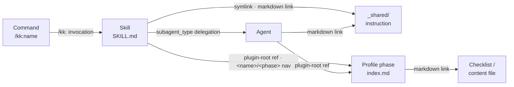

# Architecture

This document describes how Agentstakk components fit together. For conventions on authoring skills, profiles, and agents, see [`AGENTS.md`](https://github.com/serpro69/agentstakk/blob/master/AGENTS.md).

## Overview

A release contains `kk/`, the canonical Claude plugin (`klaude-plugin/`), the generated Codex skills plugin (`kodex-plugin/`) and the separate Codex guard (`kodex-guard/`). The root `install.sh` bootstraps the release. Maintainer tools and fixtures stay in the checkout. The full legacy template lives at `v0.26.0-rc.4`.

## Machine delivery

The installer writes immutable release directories under `$KK_HOME/releases/` and publishes the stable `~/.local/bin/kk` link to `$KK_HOME/bin/kk`. `kk/lib/payload.py` stages the declared payload, and `validation.py` exercises the dispatchers and registered guard adapters. Activation registers user-scope plugins through the `agentstakk-local` marketplace in each installed CLI and publishes owned Codex files. The journal in `state.json` records candidate progress, release identities, tool readiness and the rollback target. A single writer lock covers upgrade, rollback, apply and migration.

Claude loads the released plugin directory in place. Codex caches plugins by version. Its skills and guard have separate identities so an ordinary skills release can reuse the reviewed guard. `kk/baseline/` contains launcher defaults, generated agents and the generated native policy projections. `kk apply` validates and writes the owned Codex files from current overrides. For plugin-only installations, each provider manages `kk@agentstakk` from the public Git marketplace.

Rollback uses the code in the target release. Upgrade prints a recovery command that works even when the active dispatcher is broken. Pruning retains the active release, the rollback target, a pending candidate and recently superseded releases needed by open sessions. The supported window after supersession is 14 days.

## Retirement script maintenance

`kk/lib/migrate.py` pins the retirement script and its sibling `semver-compare.sh` to the same tag. To patch migration behavior in the last full template, follow these steps.

1. Branch **from the retirement tag** so the script, helper and template still match. Apply the migration fix and run `bash test/test-template-sync.sh` on that branch.
2. Publish just a maintenance Git tag on the tested commit, for example `v0.26.0+retirement.1`. The migration downloader reads Git tags directly. The suffix keeps the tag outside the numeric stable-tag filter that moves the documentation’s `latest` alias. Leave GitHub’s latest release pointing to the current machine release. The normal stable release workflow publishes from `master` and is for releasing kk itself.
3. On the normal release line, move `RETIREMENT_VERSION` to that maintenance tag for the next kk release. Until then adopters can select the patch with `kk migrate --retirement-version TAG`.

Keep the default branch’s compatibility script in place for old sync clients. Stable kk uses `v0.26.0-rc.4` because it contains both the full template and its retirement logic. [ADR 0014](../adr/0014-machine-level-delivery.md)

## Components

### kk Plugin (`klaude-plugin/`)

The canonical source of truth for all workflow functionality. Contains:

- **`skills/`** — 16 workflow and utility skills (/kk:design, /kk:implement, /kk:review-code, /kk:test, /kk:document, /kk:clarify-docs, /kk:handoff, etc.)
- **`commands/`** — Slash commands for isolated/variant invocations
- **`agents/`** — Sub-agent definitions (code-reviewer, design-reviewer, spec-reviewer, architecture-reviewer, eval-grader, profile-resolver)
- **`profiles/`** — Per-domain content (Go, Java, JS/TS, Kotlin, K8s, Python) with detection rules, review checklists, implementation gotchas, design prompts, test validators, and doc rubrics
- **`hooks/`** — Session instructions and plugin-root export at `SessionStart`, permission guard at `PreToolUse`
- **`instructions/`** — Behavioral instructions and the Git-marketplace plugin-root guidance
- **`statusline/`** — Basic and enhanced Claude statusline scripts
- **`scripts/`** — Plugin-root resolver and canonical `guard/` wrapper, Python engine, policy declaration and license

Skills reference shared instructions via symlinks to `skills/_shared/`. Profiles are referenced via `${CLAUDE_PLUGIN_ROOT}/profiles/` paths (substituted at plugin-load time by the Claude Code harness).

`/kk:handoff` is an explicitly invoked, instructions-only utility that publishes
active-task context and a starter prompt to a new secret GitHub gist using `gh`.
It has no runtime helper, lifecycle hook or indexing dependency. Its nested
`agents/openai.yaml` is Codex invocation metadata copied unchanged by generation,
not a sub-agent definition. Both hosts disable implicit invocation. The CLI stub
under its `evals/` directory is offline test support only.

### Profile Vendoring (`cmd/vendor-profiles/`)

`scripts/go-vendor-manifest.yml` pins upstream Go guidance and maps it into
profile phases. Run `make vendor-profiles`, then `make generate-kodex` to refresh
both plugin variants. Fix transformations in the generator; direct edits to
vendored output are overwritten on the next refresh.

The generator rewrites relative Markdown links to files vendored into the same
phase and preserves external URLs. For prose navigation such as
`` See `samber/cc-skills-golang@golang-naming` skill ``, it prefers a same-phase
target, then links to a copy in another packaged phase using `../<phase>/<file>`.
If several other phases contain the source, the lexically first phase/file path
wins, independent of manifest order.

A parenthesized filename such as `(testing.md)` after a skill reference selects
that skill's `references/testing.md`. It links only when that specific file is
packaged; it does not fall back to the broader skill overview.

When a prose reference has no packaged target, its descriptive text survives as
plain `Related topics:` guidance. For example, a reference to an unvendored safety
skill still retains “nil interface trap and nil error comparison pitfalls.” Only
navigation without descriptive text is removed. Mixed reference lists retain
available targets and their surrounding description; fenced examples remain
unchanged. Index descriptions use plain-text link labels before truncation, so
previews cannot introduce broken links or extra checklist-loading edges.

### Codex Generation (`cmd/generate-kodex/`)

A Go tool that transforms `klaude-plugin/` into Codex-compatible artifacts:

- **`kodex-plugin/`** — Skills with `${CLAUDE_PLUGIN_ROOT}` and `${TOOLBOX_PLUGIN_ROOT}` resolved to relative paths, installed-path root-resolution instructions, injected headers, and copied profiles
- **`kk/baseline/codex/agents/*.toml`** — Sub-agent markdown converted to TOML with `developer_instructions` for the machine release

Driven by `scripts/kodex-generate-manifest.yml`. Run via `make generate-kodex`.

Codex resolves the plugin root from the installed skill's absolute `SKILL.md` path: the root is the parent of `skills/`. Generated relative paths such as `../../profiles/` are relative to the installed skill directory, not the consumer's working directory. The generator rewrites Claude-specific shell lookup instructions; Codex does not look up `TOOLBOX_PLUGIN_ROOT`. When delegating, the parent supplies the absolute root under `## Plugin Root` and expands checklist paths before passing them. Sub-agents report a missing root instead of discovering one themselves. Profile authoring checklists retain literal Claude variable names because they describe the canonical Claude plugin's conventions.

Agent generation also translates the canonical frontmatter `tools` list into a
`Codex Tool Access` section. `Read`, `Grep`, and `Glob` permit their native Codex
equivalents, including read-only `exec_command` calls when dedicated file tools
are unavailable. Tool wrappers such as `functions.exec` carry those calls
without granting additional operations. Capy search is included only for agents
that declare it. The eval grader keeps only file reading and its fixture-access
prohibition; the profile resolver keeps its worktree/plugin path restriction.
Unknown tool declarations fail generation instead of being silently discarded.
An explicit empty list permits no tool operations; an omitted list keeps the
source's inherited-access behavior.

These operation restrictions are instructions, not a separate Codex runtime tool
allowlist. Generated agents retain `sandbox_mode = "read-only"` and explicitly
prohibit edits, test/script execution, and permission escalation. This follows
the [Codex custom-agent configuration model](https://learn.chatgpt.com/docs/agent-configuration/subagents#custom-agents).
The `read_only_tool_guidance` transform removes contradictory Claude-only tool
claims from generated agents and runtime-read skill procedures. Canonical Claude
files and profile authoring guidance retain their provider-specific conventions.

### Permission Guard

`klaude-plugin/scripts/guard/guard-rules.json` declares secrets globs, destructive categories, temporary roots and protected configuration paths. The plugin's `guard.sh` invokes `run-guard.py` with isolated Python and checks its output; failures deny. The launcher imports the adjacent `guard.py` by absolute path, permitting Python's normal bytecode cache without adding project directories to the import search path. The standalone Codex adapters pass `--no-bytecode` to the wrapper so running a hook leaves its reviewed bundle unchanged. Each call still reloads rules/configs and evaluates the payload. The engine handles Claude file tools and Bash, Codex patch headers, and capy's three execution tools without executing submitted code. Every channel uses a stable project root for policy; the execution directory is separate.

`scripts/generate-guard.sh` projects the declaration into Claude's native secrets deny list, Codex's five unconditional native forbids, and the marked configuration tables. It copies the engine, launcher, wrapper, declaration and license byte-for-byte into `kodex-guard/scripts/guard/`. The release payload carries Claude's generated deny list in `kk/baseline/claude/deny.json` and the native Codex rules in `kk/baseline/codex/kk.rules`. `make generate-guard` regenerates these artifacts; structure checks and CI freshness checks reject drift. This generator is separate from Codex skill/agent generation.

The Claude plugin loads its own baseline, including on plugin-only installs. Codex receives the shared engine through the standalone guard plugin. The plugin anchors policy to the hook’s working directory, using the Git top level when available. Capy's own hooks retain their registration and routing responsibilities. Project `.claude/kk-guard.json` adds restrictions; user `~/.claude/kk-guard.json` supplies scoped destructive/self-modification exceptions. Neither removes secrets. When installed, native Codex forbids take precedence over guard exceptions.

Legacy projects may still have both project hooks and plugin hooks. Wrapped Claude carries a native secrets deny list. The Codex guard checks registered shell, patch and capy calls, including file reads through the shell. See [ADR 0012](../adr/0012-permission-guard-single-declaration.md) for the decision and trade-offs, [configuration](../user-guide/configuration.md#guard-configuration) for user controls, and [testing](testing.md#permission-guard-verification) for evidence limits.

### Plugin Graph Analysis (`cmd/plugin-graph/`)

A Go tool that builds a directed dependency graph of `klaude-plugin/` and reports complexity metrics, impact analysis, and structural health. It gives maintainers and review skills a measured view of the skill web rather than a felt one.

It discovers six edge types across the plugin's link taxonomy: markdown links, symlinks, `${CLAUDE_PLUGIN_ROOT}` template references, parameterized navigation paths (`<name>`/`<phase>`/`<checklist>` expanded over known sets), agent delegations (`subagent_type` table rows), and `/kk:` skill/command invocations. Edges use a **dual-layer model** — raw file endpoints drive broken-edge validation, while endpoints normalized to the owning artifact node drive metrics (fan-in/out, depth, transitive closure, coupling). Intra-artifact self-references are suppressed from the metric graph.

Subcommands: `graph` (emit the graph), `metrics` (complexity numbers), `validate` (broken-edge/orphan gate, exit 1 on findings). Output formats: `text`, `json`, `dot`, `mermaid`. Global `--root` selects the plugin directory; `--ref <git-ref>` analyzes a past commit via a throwaway `git worktree`. `graph`/`metrics` support targeted mode (positional args slice the graph to nodes reachable from a start set); `validate` rejects targets because its findings are whole-graph health signals.

Broken-edge detection exempts **non-operative sources** — links from `evals/` fixtures (deliberately partial) and `example-*.md` templates — mirroring the orphan-detection `evals/` exemption. Run via `make plugin-graph` (Go tests + `validate` against the real plugin); see [Testing](testing.md).

#### The model at a glance

The six edge types connect a handful of artifact types. Each arrow below is one edge type; the concrete graph expands these over every skill, command, agent, profile phase, and shared instruction.



For the complete, zoomable node-and-edge graph of the real plugin, see [Plugin Graph](plugin-graph.md).

#### Current metrics

Regenerated from the live plugin on every docs build (`make plugin-graph-docs`), so these numbers track the plugin as it stands:

--8<-- "contributing/_generated/plugin-graph-metrics.md"

### Repository configuration

The project keeps its Claude preferences, Codex approval and sandbox settings, and Capy registrations. Run `kk claude` or `kk codex` for the release instructions and guard. The compatibility notice is available at `.claude/toolbox/scripts/template-sync.sh` and the older CI path `.github/scripts/template-sync.sh`.

### Documentation Site (`docs/`, `mkdocs.yml`)

MkDocs Material site with a custom Tokyo Night color scheme, deployed to GitHub Pages via [mike](https://github.com/jimporter/mike) for versioned documentation.

- **`mkdocs.yml`** — Site config: Tokyo Night theme (`tokyonight:dark`/`tokyonight:light`), tabs nav, pymdownx extensions, mike versioning
- **`docs/`** — Published guides and ADRs alongside internal feature and review records excluded from the site build
- **`docs/overrides/`** — Template overrides: `main.html` (base with Space Mono font, OG tags), `home.html` (custom landing page with scroll-pinned hero→pipeline transition and matrix rain effect)
- **`docs/assets/`** — `stylesheets/tokyonight.css` (color scheme), `stylesheets/extra.css` (site-wide tweaks), `javascripts/terminal.js` (placeholder for future non-homepage JS)
- **`requirements.txt`** — Python deps (mkdocs-material, mike, mkdocs-minify-plugin, mkdocs-panzoom-plugin)
- **`.github/workflows/docs.yml`** — CI: builds and deploys via mike on master push or version tags

#### Interactive field guide

[Explore](../explore/index.md) shows what the toolbox caught while building
[capy](https://github.com/serpro69/capy), a project built with it from start to
finish. Each chapter tells one real catch: a short story, then a terminal pane
with the `/kk:` command and the exact excerpt from capy's records, with the key
phrase highlighted and every line number linked to the source on GitHub.

The page is an ordinary MkDocs page with the custom
`docs/overrides/explore.html` template; there is no frontend build. All content
is data in the front matter of `docs/explore/index.md` (`explore.chapters` and
`explore.closing`), rendered server-side by the template, so the page is
complete without JavaScript. Page-local `explore.css` lays out the copy column
and the pane (stacked below 960px) in the site's Tokyo Night terminal style;
`explore.js` only reveals each excerpt as its chapter reaches the middle of the
viewport and keeps `#<chapter-id>` in the URL. `prefers-reduced-motion` turns
the reveal off.

To edit or add a chapter, edit the front matter; the comment at its top lists
the rules. Excerpts must be the record's exact text: mark cuts with `…`, the
highlight with `[[…]]`, and give the source line or range in `at`, which also
builds the GitHub link. When a record describes a review but doesn't quote the
command, set `inferred: true`; the pane says so. Run `make docs-serve` and
open `/explore/` to preview it.

The closing figures (capy's commits, ADRs and finished feature records) are
counted at deploy time. The docs workflow makes a blob-less clone of capy and
exports `CAPY_STATS_REPO`; the MkDocs hook `scripts/mkdocs/capy_stats.py` counts
from it and writes the figures and the build date into the page. Without that
variable, as in local builds, or when the clone or the counts fail, the page
shows the snapshot figures and as-of date from the front matter, and CI reports
the reason as a warning annotation rather than blocking the deploy. Figures
refresh only when the docs deploy, and each released docs version keeps the
figures it was built with; the as-of date says which. To try it locally, run
`CAPY_STATS_REPO=../capy/.git make docs-build`.

## Installation Modes

| Mode | Installation and update owner |
| --- | --- |
| Machine-managed | `install.sh` bootstraps kk. `kk upgrade` selects one active release for the account and `kk rollback` restores a retained release. |
| Plugin-only | The vendor manages the Git-marketplace plugins and the user’s own vendor settings. |
| Legacy template | Until migration, the repository keeps its committed settings and sync infrastructure. Ordinary sync can update them through the last full template. `kk migrate` previews removal and asks the team to confirm. |

**Testing a checkout on your account.** From the Agentstakk repository root, use `./install.sh --local .` for a first installation. If kk is already installed, use `kk upgrade --local .`. Both stage and activate the checkout through the same code path as a downloaded release. For testing without changing your active installation, run `bash test/test-kk.sh` with its temporary homes. [Stable release installer](../getting-started/install.md)

### Marketplace gotchas

**Plugin source paths must use `"./"`, not `"."`** In `marketplace.json`, the `source` field for each plugin entry must use `"./"` (with trailing slash) for repo-root plugins, not bare `"."`. Claude Code's path resolver does not treat them equivalently — `"."` causes `plugin install` to fail with a misleading "source type not supported" error. Paths to subdirectories (e.g., `"./klaude-plugin"`) already include the `"./"` prefix and are unaffected.

**Stale marketplace cache after fixing.** Claude Code caches cloned marketplace repos under `~/.claude/plugins/`. After fixing `marketplace.json` and pushing, `marketplace add` or `marketplace update` may still use the stale cache. For a clean slate: remove the marketplace entry from `~/.claude/plugins/marketplaces/<name>/`, delete any references in `~/.claude/plugins/known_marketplaces.json` and `~/.claude/plugins/installed_plugins.json`, then re-add with `claude plugin marketplace add`.

## Data Flow

### Skill execution

```
User invokes /kk:review-code
  → Claude Code loads SKILL.md (${CLAUDE_PLUGIN_ROOT} substituted)
  → Skill reads shared instructions via symlinks
  → Profile detection runs (git diff --stat → DETECTION.md matching)
  → Profile content loaded (index.md → always-load + conditional files)
  → Subject-matter action (read diff, produce findings)
```

### Legacy template sync at `v0.26.0-rc.4`

```
Downstream repo triggers sync workflow
  → Sparse-clones upstream at specified version
  → Reads .github/template-state.json for variables and exclusions
  → Copies .claude/, .codex/ to staging
  → Applies variable substitutions (CC_MODEL, CODEX_MODEL, etc.)
  → Smart-merges settings.json except permissions.deny (replaced from upstream)
  → Reports removed deny entries; leaves project kk-guard.json alone
  → Creates PR with changes
```

### Documentation publishing

```
Push to master
  → .github/workflows/docs.yml triggers
  → mike deploy --push dev (unreleased docs)

Push tag v0.14.0
  → .github/workflows/docs.yml triggers
  → Extracts major.minor → "0.14"
  → mike deploy --push --update-aliases "0.14" latest
  → mike set-default --push latest (bare URL → latest release)
  → GitHub Pages serves from gh-pages branch
```

### Codex generation

```
make generate-kodex
  → go test (unit tests for generation tool)
  → go run cmd/generate-kodex -manifest scripts/kodex-generate-manifest.yml
    → Copy skills with ${CLAUDE_PLUGIN_ROOT} → relative path transform
    → Copy profiles as-is
    → Convert agents/*.md → agents/*.toml
    → Generate .codex-plugin/plugin.json
  → make test-structure (validate bidirectional invariants)
```

## ADRs

Architecture decisions are recorded in `docs/adr/`:

| ADR | Decision |
|-----|----------|
| [0001](../adr/0001-profile-detection-model.md) | Profile detection model (path → filename → content signals) |
| [0002](../adr/0002-profile-content-organization.md) | Profile content organization (per-phase subdirectories) |
| [0003](../adr/0003-plugin-root-referenced-content.md) | Plugin-root referenced content (no symlinks into profiles) |
| [0004](../adr/0004-skill-workflow-ordering.md) | Skill workflow ordering (instructions before action) |
| [0005](../adr/0005-codex-hook-enforcement-gap.md) | Codex hook enforcement gap (advisory + hook two-layer approach; superseded by 0013) |
| [0012](../adr/0012-permission-guard-single-declaration.md) | Single permission declaration, generated projections and scoped guard configuration |
| [0013](../adr/0013-codex-file-access-through-hooked-tools.md) | Codex file access is guarded through hooked tools (exec_command, apply_patch, capy) |
| [0014](../adr/0014-machine-level-delivery.md) | Machine-level installation, offline rollback and explicit repository migration |
