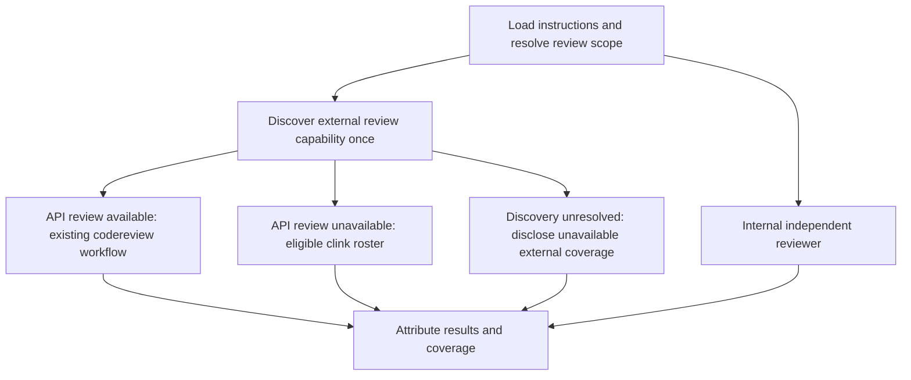

# Clink fallback for isolated reviews

> Status: design reviewed; Task 0 verified against the recorded corrected PAL build; Task 1 (code review path) implemented 2026-10-23; Task 2 (design review path) implemented 2026-10-24; Task 2b (shipped-client provider defaults) implemented 2026-10-24; Task 3 pending
> Created: 2026-10-11
> Issue: [claude-toolbox #168](https://github.com/serpro69/claude-toolbox/issues/168)
> Implementation: [implementation.md](implementation.md)
> Tasks: [tasks.md](tasks.md)
> Prerequisite: Task 0 verifies the implemented new PAL contract before plugin instruction authoring starts

## Problem and outcome

Developers invoking `/kk:review-code:isolated` or `/kk:review-design:isolated` should retain external review when PAL has no API-backed review available at discovery. Today both workflows select an API model and invoke `pal codereview`; an unavailable external reviewer leaves only the internal reviewer.

Use PAL's new CLI-only contract to select clink at discovery, then request one independent review from every eligible non-authoring provider using its configured review model. Keep the existing internal `code-reviewer` or `design-reviewer`. The parent supplies equivalent criteria and evidence, collects attributed results, and reports failures and actual coverage.

Success is observable: API-available discovery produces zero clink calls, including after an API execution failure; API-unavailable discovery attempts every eligible provider once; no authoring-provider client is selected; and both review skills preserve their existing scope and review criteria. No benchmark or improvement in defect-detection rate is claimed.

## Confirmed decisions

The user explicitly chose:

1. Every available external provider, excluding the authoring provider.
2. Configured review models, without automatic strongest-model discovery.
3. The new PAL contract, without compatibility support for older installations.
4. A Task 0 that verifies our contracts and needs before skill instructions are authored.
5. Both isolated review skills.
6. Clink only when API review is unavailable at discovery. Runtime fallback was rejected because it adds too many branches for the main agent.

The shared instruction organization and checks below implement that direction. They are proposed requirements, not claims that PAL's pending features or this integration already work.

### Review corrections (2026-10-21)

After requesting revalidation and fixes for all valid review findings, the user authorized these corrections. C7 now verifies honest coverage classification rather than requiring PAL to expose read telemetry; absent telemetry limits review claims without blocking the feature. The no-edit contract requires reviewer behavior and `allow_edits=false` on every request, while preserving native permission settings; it does not promise an enforced filesystem sandbox. These corrections supersede the original C7 telemetry prerequisite and C4/C5 permission wording. Task 0 remains mandatory, and no unrun check is considered passed.

### Review corrections (2026-10-24)

After Task 2 the user authorized a change to the roster's provider-identity rule. Requiring every consumer repository to declare the provider of PAL's four shipped clients was opt-in ceremony for the common case, while the guarantee it protected (no same-provider "independent" review) is only weakened, not broken, by a wrong default, provided the report says which providers were assumed. Therefore: for PAL's shipped client names (`claude`, `codex`, `agy`) the protocol applies a default provider mapping (Anthropic, OpenAI, Google) when no operator declaration exists, and labels each roster entry's provider source as **declared** or **assumed from shipped manifest**. An operator declaration (request, project agent instruction file, identified client configuration) overrides a default. Any other client name still has no provider until declared and remains part of the single roster question. C2's prohibition on guessing a provider from a custom name is retained; the one-client-per-provider rule still asks for a choice when an operator declares two clients for one provider. Corroboration that rests on an assumed provider is reported as such. This supersedes the "declare or ask" wording in §Discovery and reviewer selection, rules 3–4.

The user also retired the `gemini` CLI client in the same decision: it is obsolete tooling that nobody uses, `agy` is the Google client, and a `gemini` entry advertised by PAL is never a candidate. This removes the agy-versus-gemini duplicate case from the roster entirely; Task 0's historical gemini observations stay as recorded.

## Existing mechanisms and provenance

Repository baseline: `581dd0e11455398cb73e3d6ae5542854c016fe7f`.

| Existing artifact | Relevant responsibility |
| --- | --- |
| [Code isolated workflow](../../../../klaude-plugin/skills/review-code/review-isolated.md) | Loads criteria before investigation; prepares selected candidate and historical evidence; launches an internal reviewer and an API reviewer; preserves coverage limits |
| [Design isolated workflow](../../../../klaude-plugin/skills/review-design/review-isolated.md) | Resolves document scope; launches a design reviewer and an API reviewer; annotates attributed findings |
| [Shared PAL invocation](../../../../klaude-plugin/skills/_shared/pal-codereview-invocation.md) | Two-step API transport with separate code/document branches and native external output |
| [Code reviewer](../../../../klaude-plugin/agents/code-reviewer.md) | Independent behavioral, compatibility, security and quality investigation |
| [Design reviewer](../../../../klaude-plugin/agents/design-reviewer.md) | Document quality, technical soundness and cross-document consistency checks |
| [Code command wrapper](../../../../klaude-plugin/commands/review-code/isolated.md) | Advertises and routes isolated code review; currently assumes two reviewers |

There is no `klaude-plugin/commands/review-design/isolated.md` at this baseline. The design skill documents its isolated mode directly; this feature does not introduce a new command family.

Canonical plugin instructions live in `klaude-plugin/`. `make generate-kodex` generates the Codex skill tree and agent definitions. Existing completed feature documents remain frozen.

### PAL sources and implementation boundary

The following upstream plans were inspected on 2026-10-11; the recorded PAL `main` revision is `c276e0ca6669d81baa5fd09bb519f495f985a1e9`. Task 0 must inspect the actual candidate implementation and record its own revision and schemas.

- [CLI-only clink](https://github.com/serpro69/pal-mcp-server/blob/c276e0ca6669d81baa5fd09bb519f495f985a1e9/docs/feat/wip/cli-only-clink/design.md) plans provider-free startup, executable discovery, CLI diagnostics in `listmodels`, and provider-independent continuation. Its task list was pending at design time. Executable presence does not verify login or inference.
- [Server reliability](https://github.com/serpro69/pal-mcp-server/blob/c276e0ca6669d81baa5fd09bb519f495f985a1e9/docs/feat/wip/server-reliability-and-capabilities/design.md) plans request isolation, CLI environment/working-directory changes and more accurate outcomes. Concurrent dispatch depends on the relevant verified behavior, not completion of the whole roadmap.
- [Per-file descriptions](https://github.com/serpro69/pal-mcp-server/blob/c276e0ca6669d81baa5fd09bb519f495f985a1e9/docs/feat/wip/per-file-descriptions/design.md) excludes clink. The categorized path manifest remains in the prompt; do not invent a clink `file_descriptions` parameter.
- [Antigravity clink](https://github.com/serpro69/pal-mcp-server/blob/c276e0ca6669d81baa5fd09bb519f495f985a1e9/docs/feat/wip/antigravity-clink/design.md) proposes another client, gated on permission and authentication evidence. A planned client is not automatically eligible.

Current clink exposes configured clients/roles and file-reference inputs, while model selection is CLI configuration. These observations guide Task 0; they do not freeze a future schema or prove runtime access. Context7 returned the original BeehiveInnovations project, not version-matched coverage of this fork's new contract; the fork's source and plans are authoritative here.

## Architecture and ownership

Keep review policy in the plugin and execution/configuration in PAL. Do not add a toolbox CLI registry, launcher, login manager, model catalog or execution service.

Add one shared `skills/_shared/external-review-invocation.md` protocol for discovery, roster selection, clink dispatch and external-result bookkeeping. Both isolated skills consume it through their own `shared-external-review-invocation.md` symlink. Retain `pal-codereview-invocation.md` as the API transport and load it explicitly from each caller before investigation. The shared external protocol refers to that already-loaded procedure; it does not repeat the two-step call specification.

The caller owns scope, instruction loading, evidence preparation, the internal reviewer, annotation and the final verdict. The shared protocol owns the one-time external backend decision and a uniform record of reviewer outcomes. PAL owns executable resolution, configured CLI arguments/models, subprocess behavior and conversation storage.

There is no edge from an API execution failure to clink. Backend choice stays fixed for this review invocation, including clarification and evidence follow-ups.

## Discovery and reviewer selection

Perform discovery before dispatch, after loading the relevant instructions. It needs no source investigation. Use the advertised tool surface and new PAL discovery contract verified by Task 0, rather than inspecting API secrets or guessing from error messages.

| Discovery outcome | External action |
| --- | --- |
| `codereview` is callable and discovery supplies an eligible API model | Existing API review path; preserve its model-selection policy |
| Discovery establishes that the API review tool is unavailable or no eligible API model exists, and clink is callable | Build the eligible clink roster |
| Discovery fails, is ambiguous, or PAL cannot be reached | Report discovery failure; retain the internal review; do not treat uncertainty as an empty model catalog |
| API review is unavailable and clink is unavailable or has no eligible candidates | Internal review only, with explicit external coverage limits |

Once API review starts, errors in either step or continuation remain API failures under the existing degradation rules. Do not re-run discovery to turn a failure into clink eligibility. A later separately requested review is a new invocation.

For the clink roster:

1. Use PAL-discovered, executable-present, review-capable clients. Authentication is attempted through the review request, not a separate login or inference probe.
2. Resolve the authoring provider from explicit authorship/session context. The host CLI of a later review session is not proof of who authored the target. If the authoring provider cannot be established, ask one focused question before clink dispatch; the internal review can still proceed.
3. Exclude the authoring provider. Provider denotes the model provider, not merely the executable name. Task 0 must establish how PAL/operator configuration makes that identity reliable. Unknown client identity is reported as ineligible until resolved; do not guess from a custom name. _Amended 2026-10-24 (see [Review corrections](#review-corrections-2026-10-24)): PAL's shipped client names receive a default provider when undeclared, labeled as assumed in the report; custom names still require a declaration._
4. Select one configured reviewer client per remaining provider. If several clients map to the same provider and there is no declared review choice, ask for that mapping rather than silently selecting or counting duplicate providers as additional diversity.
5. Attempt every eligible provider. Freeze the roster for this invocation; disclose exclusions and failures. Do not fall back to the authoring provider, substitute another model, or repeatedly retry a failed client.

Configured model selection stays in PAL/CLI review-role configuration. Do not set a model by prompt text, invent a clink model parameter, or rewrite user configuration during review. Record configured and observed model identity separately; unknown returned identity remains unknown.

## Instructions, evidence and execution

### Common contract

Each clink reviewer gets a new conversation and the same relevant evidence as the internal reviewer. Supply absolute paths and explicitly categorize criteria versus review targets. Load all applicable criteria before evidence. The prompt contains factual scope/context, not the author's conversational history or another reviewer's conclusions.

Use the review role verified in Task 0; the current `codereviewer` preset alone is not sufficient methodology. The prompt must direct the CLI to perform the review itself, avoid recursive isolated-review invocations, make no project-file edits, and return findings and coverage. Use `allow_edits=false` on every request, including follow-ups. Missing read permissions stay visible; do not enable edits or bypass controls to make a review work.

This is a no-edit behavior contract, not a guarantee of enforced read-only access. Some clients, including `agy`, preserve native permissions when `allow_edits=false`. Record and disclose that limitation; inherited permissions alone do not exclude a client. Do not change user permissions. C4 verifies access and unchanged fixture files during the tested review, without claiming that writes were impossible. Any observed project-file modification violates the contract. C5 verifies that a prior request's edit opt-in is not reused; it does not require erasing the operator's native permission policy.

Do not copy entire agent definitions, including their host-specific tool/model declarations, into external prompts. Reuse actual methodology files and add only transport-specific instructions. Preserve native external severity and formatting; internal-agent output formats remain unchanged.

### Code review

Reuse the existing four common criteria files: `functional-review.md`, shared change context, task-scope protocol and knowledge protocol, plus every resolved profile checklist. Retain the general correctness/security/architecture/quality framing from the existing API branch. Reconcile exact instruction paths before submission; an index or remembered summary cannot replace a loaded checklist.

Pass the selected diff, candidate source, relevant unchanged consumers, historical source with provenance, and intent/context. Selected index/revision snapshots remain authoritative when the worktree differs. A clink reviewer must not substitute its own default `git diff` or unrelated current files. The complete manifest is attached to the first clink review; the API branch's diff-only planning call is not a clink convention.

### Design review

Preserve default all-document scope and explicit `design`, `implementation` or `tasks` scope. Pass only the selected document targets plus relevant existing source, and disclose missing requested documents.

Extract the reusable document-quality, technical-soundness, feature-value, task-format and cross-document checks into `skills/_shared/design-review-criteria.md`. The internal design reviewer and clink document-review branch read that same checklist before evaluating targets. Keep agent identity, access restrictions and structured output in the agent wrapper. Explicitly frame the external request as document review so a generic code-review role does not report planned implementation as missing code.

### Scheduling and follow-ups

Use one invocation-local reviewer record per provider: backend, client/provider identity, configured/observed model, requested scope, supplied evidence, outcome, coverage and continuation identifier. This is review bookkeeping, not a new persistent service or public JSON API.

Dispatch independently in parallel only when Task 0 verifies relevant PAL request isolation and the host supports it. Otherwise dispatch sequentially over the same roster; this changes scheduling, not selection. Never share a continuation identifier between reviewers or reuse an authoring conversation.

For focused evidence requests, obtain the missing source, load new criteria if needed, and send equivalent relevant additions to affected reviewers without sharing their conclusions. Follow-ups use the requesting reviewer's own continuation. If continuation is unavailable, disclose it; any necessary re-invocation uses the same provider/backend, original scope, that reviewer's own provisional output, and new evidence. It is not a retry loop or permission expansion.

## Results, failures and corroboration

Distinguish requested providers, attempted requests, successful executions and adequately evidenced reviews. A successful process or fluent answer alone does not establish instruction loading, source receipt, complete coverage or approval.

Report each failed or partial external reviewer while preserving other useful results. Semantic error envelopes, permission denials, missing evidence, truncated/summarized responses and unknown source receipt qualify coverage even when the transport returns success. Task 0 must establish which receipt evidence the implemented PAL exposes; a reviewer-authored list of files or plausible citations alone does not satisfy the existing code-review receipt rule.

Merge duplicate issues once and list every supporting reviewer. Mark a finding corroborated only when at least two independent reviewers support it with relevant observable evidence; identify their actual providers. Two external reviewers may corroborate an issue the internal reviewer did not flag. Preserve severity disagreements and native external findings; do not turn a majority vote into an automatic verdict or suppress a serious single-reviewer finding.

Keep existing skill-specific verdicts, author-context annotation and knowledge indexing. Report selected scope, attempted roster, failures, evidence limits and outstanding prerequisites even when there are no findings. If all reviewers fail, report that isolated review did not complete and suggest the existing standard mode; do not silently execute it.

## Task 0 acceptance contract

Task 0 is a development prerequisite, not an extra procedure performed before every user review. It produces `verification/pal-contract.md` and minimal redacted evidence under this feature directory. Every required row must pass against the implemented PAL candidate before plugin authoring starts. Missing access, skipped checks and planned behavior are not passes.

| ID | Required check | Acceptance evidence |
| --- | --- | --- |
| C1 | Provider-free startup and discovery; API available/unavailable/unknown distinction | Recorded PAL revision, actual tool schemas and representative discovery responses; tool omission and empty API catalog cases |
| C2 | Executable availability, review roles and provider identity | Eligible/excluded roster examples, including author exclusion, unknown identity and duplicate-provider configuration; authentication remains unverified until use |
| C3 | Configured review models | Effective review-role configuration and returned identity behavior; no invented per-call model field or configuration mutation |
| C4 | Instruction/evidence access and no-edit behavior | Live disposable fixture with plugin criteria, project files and outside-worktree snapshots; demonstrate access using file-only fixture content or observed read events, verify unchanged fixture files, and record effective working-directory and native permission behavior without inferring enforcement from an unchanged fixture |
| C5 | Fresh conversations and provider-free continuation | Independent initial requests and a context-dependent follow-up; no cross-review history, reuse of a prior request's edit opt-in or API-provider context requirement; `allow_edits=false` on every request |
| C6 | Failure and output semantics | Missing executable, authentication/error result, permission-denied partial result, timeout and truncation/summary cases stay distinguishable from an adequately sourced review |
| C7 | Accurate instruction/source coverage reporting | Record available returned or controller-observed read evidence, including its absence; demonstrate that unverified receipt preserves useful attributed findings but cannot establish corroboration or broad approval |
| C8 | Complete multi-provider run | Internal-review payload parity plus every eligible external provider once; record attempted/successful/failed coverage, with no authoring-provider or API substitution |

C7 tests reporting behavior, not telemetry availability. A client with no exposed read telemetry can pass that check when receipt stays unverified and the report respects the resulting limits; it does not thereby pass a source-read check. C4 still requires live evidence of access and no-edit behavior for its fixture. File-only fixture content must not be supplied in the prompt, and its return demonstrates only that tested access, not complete receipt in later reviews. Missing or skipped live checks remain unverified.

Record concurrent isolation separately. A failed concurrent check fixes scheduling to sequential until verified; all C1–C8 requirements still apply. This avoids making the whole reliability roadmap a dependency.

Task 0 must record exact schemas, supported role/model configuration and a reproducible minimum PAL revision/release. Resolve mismatches upstream or revise this design explicitly. Do not invent compatibility branches, lower evidence requirements or begin instruction authoring while a required contract is unresolved. Upstream issue creation requires its own authorization; local gap records are sufficient to retain the work.

## Assumptions

- The new PAL build supports both initial and follow-up CLI-only reviews without API credentials; verify C1/C5.
- Provider identity and configured review models can be established without guessing or inspecting credentials; verify C2/C3. The inspected plans do not establish a universal identity API.
- The CLI can read criteria and evidence outside its working directory and obey no-edit instructions with `allow_edits=false`; verify C4. Native permissions may remain inherited, so enforced read-only access is not assumed.
- Read-receipt telemetry may be unavailable. Verify honest coverage reporting under C7; planned conversation transcripts and reviewer-authored file lists alone do not prove child file reads.
- Multiple independent requests can be scheduled safely; verify concurrent isolation or choose sequential dispatch in Task 0.
- Existing generation preserves shared-file links and reviewer instructions for both hosts; verify generated output and structure tests during implementation.

## Not Doing

- Runtime API-to-clink fallback: explicitly rejected to keep one discovery-time decision.
- Old PAL compatibility: the new verified contract is the prerequisite.
- Changes to standard review modes or other review skills: the feature covers the two selected isolated workflows.
- Automatic model ranking, model rotation, CLI installation, authentication or account changes: configuration belongs to PAL and the operator.
- An external review from the authoring provider, or several duplicate clients counted as distinct providers: conflicts with the selected coverage policy.
- New review orchestration infrastructure, a permanent review database or a general eval runner: instructions and focused fixtures suffice.
- PAL feature implementation in this repository: missing capabilities are recorded by Task 0 and resolved upstream.

## Rejected Alternatives

| Alternative | Rationale |
| --- | --- |
| One external CLI reviewer | Lower cost, but the user selected every available non-authoring provider for broader coverage |
| Prompt for the reviewer roster every time | Adds routine interaction when verified discovery and configuration already settle selection |
| Automatically select the strongest model | Requires uncertain model discovery/ranking; configured review models were selected |
| Switch to clink after an API failure | More branching and recovery state; explicitly rejected by the user |
| Duplicate the full isolated agent prompt per CLI | Causes methodology drift and carries host-specific execution assumptions |
| Treat the current PAL implementation as the compatibility baseline | Misses provider-free continuation/discovery work already underway |

## Verification, rollout and rollback

Task 0 proves the PAL boundary. Behavioral evals then prove instruction routing, scope, independence and reporting under controlled responses. Run both supported host variants; include a live code fixture and scoped document fixture against the verified PAL build. Structural checks establish packaging/link integrity, not review behavior.

Update user-facing isolated-mode documentation with discovery-only routing, variable reviewer count, configured model ownership, cost implications, minimum PAL requirement and the limits of no-edit controls and source-receipt evidence. Generate Codex output from canonical sources after each implementation slice. Rollback removes the new routing/clink integration and regenerates; it restores the existing API-only isolated workflows without changing user PAL configuration.

The design review corrections are recorded in [Review corrections](#review-corrections-2026-10-21). Task 0 passed for the corrected local PAL candidate recorded in [verification/pal-contract.md](verification/pal-contract.md); [the Linux record](verification/linux-20261023/README.md) preserves the original discovery gap, its verified fix and deployment limits. Skill implementation remains pending and may use that verified contract.
